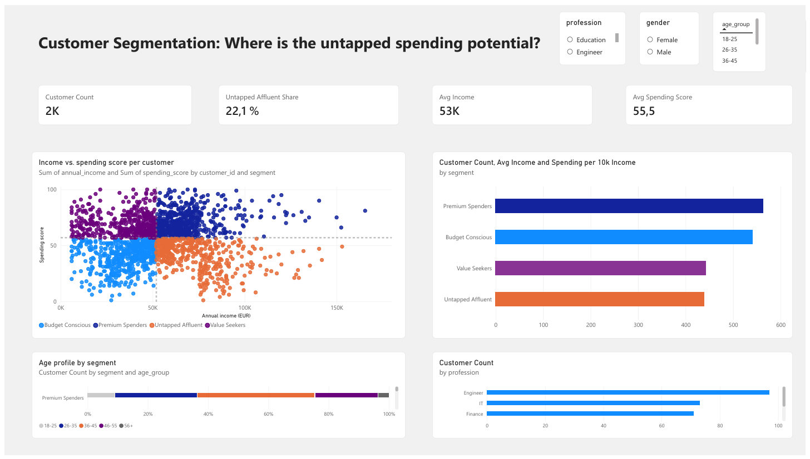

# Power BI Dashboard: Customer Segmentation



An interactive one-page dashboard that answers the project's business question: **where is the untapped spending potential among our customers?**

## Data connection

| Setting | Value |
|---|---|
| Source | Azure SQL Database |
| Object | View `dbo.v_customer_segments` |
| Mode | Import |
| Authentication | SQL Server (database) login |
| Table name in Power BI | `Customers` |

The dashboard reads from a SQL view rather than an exported file, so **Home → Refresh** pulls the latest data directly from the database.

Only the detail view is loaded. The summarised views (`v_segment_kpis`, `v_profession_ranking`) are not used here, because pre-aggregated data cannot react to slicers. Instead, all KPIs are calculated as DAX measures on the customer-level data.

## DAX measures

```dax
Customer Count = COUNTROWS(Customers)

Avg Income = AVERAGE(Customers[annual_income])

Avg Spending Score = AVERAGE(Customers[spending_score])

Share of Customers =
DIVIDE([Customer Count], CALCULATE([Customer Count], ALL(Customers[segment])))

Untapped Affluent Share =
DIVIDE(CALCULATE([Customer Count], Customers[segment] = "Untapped Affluent"), [Customer Count])

Spending per 10k Income =
AVERAGEX(Customers, Customers[spending_score] * 10000 / Customers[annual_income])
```

| Measure | Purpose |
|---|---|
| Customer Count | Number of customers in the current selection |
| Avg Income / Avg Spending Score | Profile of the current selection |
| Share of Customers | Each segment's share of all customers in the selection |
| Untapped Affluent Share | Size of the target group in the selection |
| Spending per 10k Income | How much of their income customers actually spend |

## Visuals

| Visual | Fields | What it shows |
|---|---|---|
| 4 KPI cards | Customer Count, Avg Income, Avg Spending Score, Untapped Affluent Share | Headline numbers |
| Scatter chart | X: annual_income, Y: spending_score, Values: customer_id, Legend: segment | One dot per customer; constant lines at the medians (EUR 52,000 and 57) mark the four segments |
| Bar chart | segment, Customer Count | Size of each segment |
| 100% stacked bar chart | segment, Customer Count, Legend: age_group | Age profile of each segment |
| Bar chart (Top 5) | profession, Customer Count, filtered to Untapped Affluent | Who the target group is |
| Slicers | gender, age_group, profession | Interactive filtering of all visuals |

Each segment keeps the same colour across all visuals, with Untapped Affluent highlighted as the focus segment.

## Validation

With no slicer selected, the dashboard matches the SQL results:

| Check | Expected |
|---|---|
| Customer Count | 1,989 |
| Untapped Affluent customers | 440 (22.1%) |

## Files

| File | Description |
|---|---|
| `customer_segmentation.pbix` | Power BI Desktop file |
| `customer_segmentation.pdf` | PDF export, viewable without Power BI |
| `dashboard.png` | Screenshot used above |

To open the `.pbix` with your own database: **Transform data → Data source settings → Change source**, enter your server and database, then refresh.
